<div align="center">

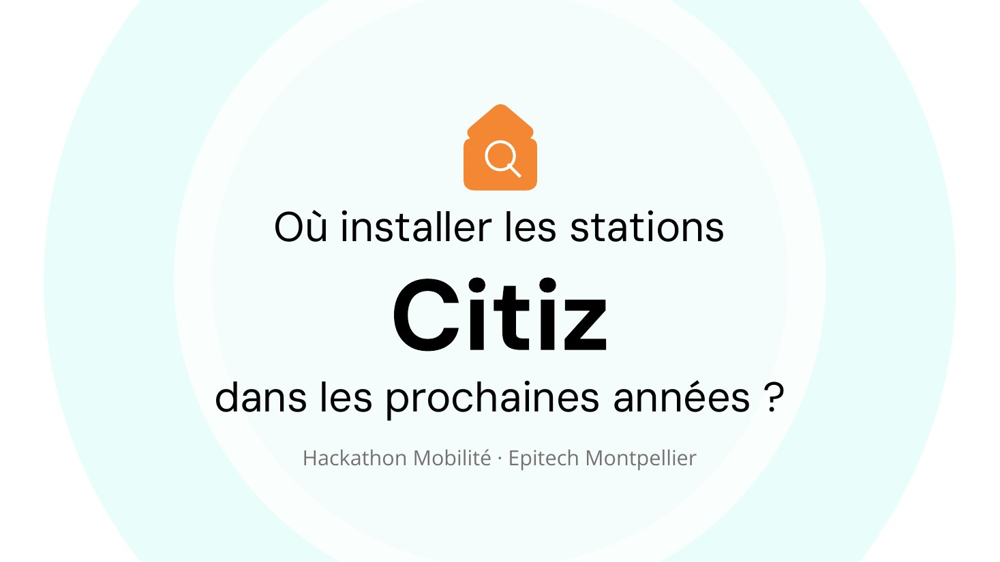

# Citiz — where should the next stations go?

**A decision-support tool that predicts where people will live and places car-sharing stations where they serve the most residents, at the lowest cost.**

<p align="center">
  
  
  
  
  
  
</p>

</div>

> 🎓 A team project built during the **Epitech Mobility Hackathon** (Montpellier campus, module **T-HAK-700**) for **Citiz**, France's leading cooperative car-sharing network.

---

## 🎯 Context and problem

Buses, trams, bike and scooter sharing, car sharing: mobility options keep growing, but they are very unevenly spread. Since the French Mobility Orientation Law (LOM), most of these services publish open data (GTFS, GBFS), and so does demographic data.

Citiz runs about **2,800 shared cars** in some **280 towns**, used by nearly **130,000 drivers**. Like any operator, Citiz has to choose where to open its next stations to reach the most residents, complement the existing offer and find its users.

The brief asked for three things:
1. **Map access** to mobility within a 5-minute walk.
2. **Show who is affected**: existing stations and stops, and the population around them.
3. **Recommend where to invest** with a prediction and optimisation tool under a budget constraint: the core of the project.

> **Our question: where should Citiz install stations in the coming years?**
> What sets us apart: we don't look at where people live *today*, but where they will live **in 2030**, by predicting the growth or decline of every neighbourhood.

<p align="center">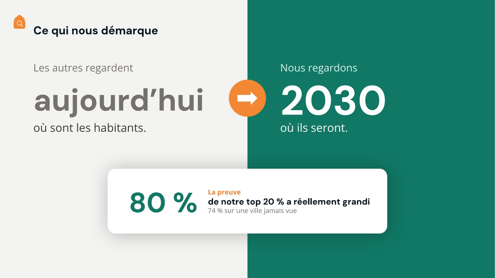</p>

---

## 🧭 Approach

5 metropolitan areas where Citiz publishes an open GBFS feed and the urban network publishes a GTFS feed, with contrasting demographic trends: **Bordeaux, Grenoble, Lille, Rennes, Toulouse**. The unit of analysis is the **IRIS** (INSEE's statistical neighbourhood unit, about 2,000 residents).

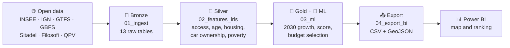

1. **Predict**: a linear regression (scikit-learn) learns each IRIS's annual growth rate over 2015-2021 from 6 features (log population and log density, shares of ages 0-14, 15-29 and 60+, housing units authorised per resident per year from Sitadel, the national building-permit database). The 2030 projection is calibrated on INSEE's Omphale departmental projections. It is benchmarked against a simple mean and a gradient boosting model.
2. **Measure the need**: we count 2030 residents living more than **350 m** (a 5-minute walk, Héran & Pouillaude) from any existing service.
3. **Score**:

   ```
   score = residents served in 2030 × (1 + 0.5 × car ownership + 0.5 × equity)
   ```
   Car ownership (rank within the city) targets households that could give up a car; equity (Filosofi poverty rate or QPV, France's priority urban neighbourhoods) keeps the offer from going only to well-off areas.
4. **Optimise**: sites are ranked by **score per euro** and picked greedily up to **€500,000 per city**. A Citiz station costs **€39,660 incl. VAT over 5 years** (€7,250 excl. VAT setup + 5 × €5,160 excl. VAT per year, electric car included, 20% VAT); a bus stop costs **€15,000**.

<p align="center">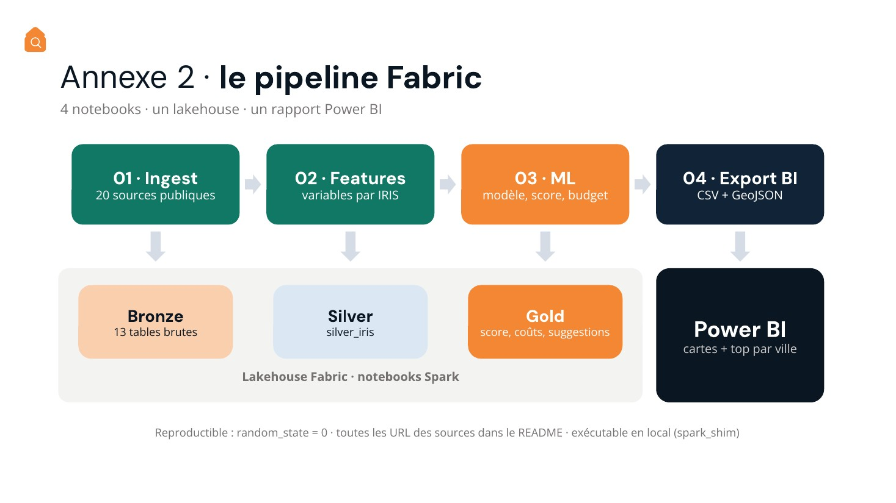</p>

---

## 📈 Key figures

| Indicator | Value |
|---|---|
| Metropolitan areas studied | **5** |
| IRIS used for training | **1,403** |
| Selected model | Linear regression, **R² 0.12** (5-fold) |
| Share of the predicted top 20% that actually grew | **80.1%** (KFold) · **74.0%** (unseen city) · 60.2% on average |
| Recommended sites | **72** (53 Citiz stations, 19 bus stops) |
| Total budget | **€2,386,980** incl. VAT over 5 years (≤ €500k per city) |
| Newly served residents in 2030 | **174,412** |
| Cost per resident served | **€13.7** |
| Sites in a priority neighbourhood (QPV) | **34.7%** (25 of 72) |

| City | Sites | Cost | Residents served in 2030 |
|---|---:|---:|---:|
| Bordeaux | 12 | €475,920 | 38,973 |
| Grenoble | 13 | €466,260 | 29,284 |
| Lille | 16 | €486,600 | 38,752 |
| Rennes | 14 | €481,260 | 29,684 |
| Toulouse | 17 | €476,940 | 37,719 |

**Example**: in Toulouse, site #1 is **Cité Amouroux**: 4,253 residents in 2030 living more than 350 m from any Citiz station, 77% of households own a car, score 6,932, for €39,660.

**Robustness** (`analysis/`): varying both weights from 0 to 1 (24 variants), 87.5% of sites stay recommended at the median (68% in the worst case) and each city's top 5 is 100% preserved at the median (88% in the worst case). Results are mostly sensitive to the distance threshold: 90.3% of sites kept at 300 m, 47.2% at 500 m.

---

## 🖼️ Preview

<p align="center">
  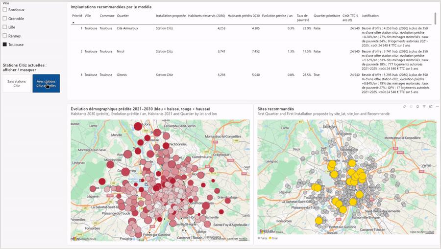
</p>

> 🎬 Video demo: [`assets/demo_powerbi.mp4`](assets/demo_powerbi.mp4) — hover a neighbourhood, click-to-zoom, recommended sites, current Citiz stations toggle, city switch.

<table>
  <tr>
    <td width="50%">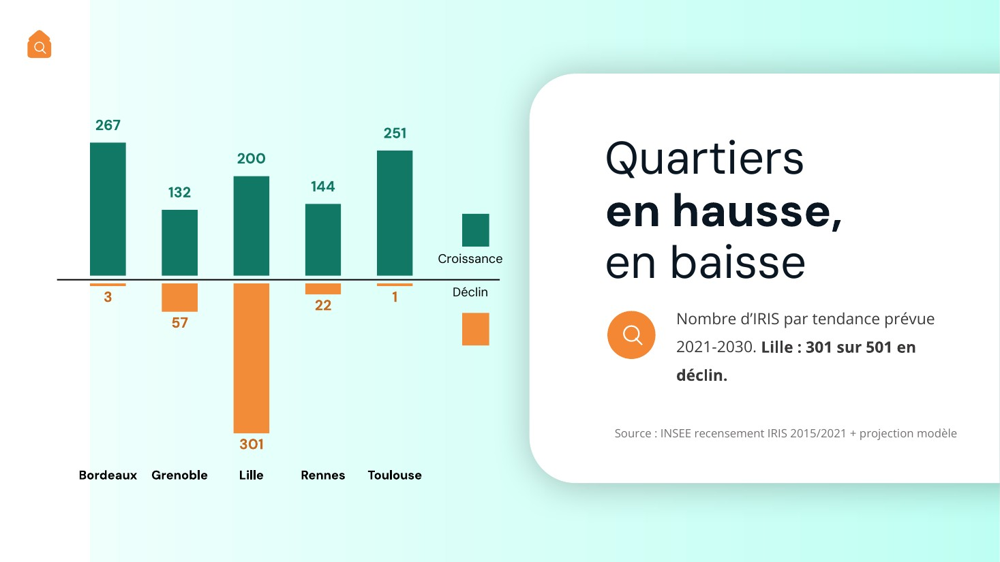</td>
    <td width="50%">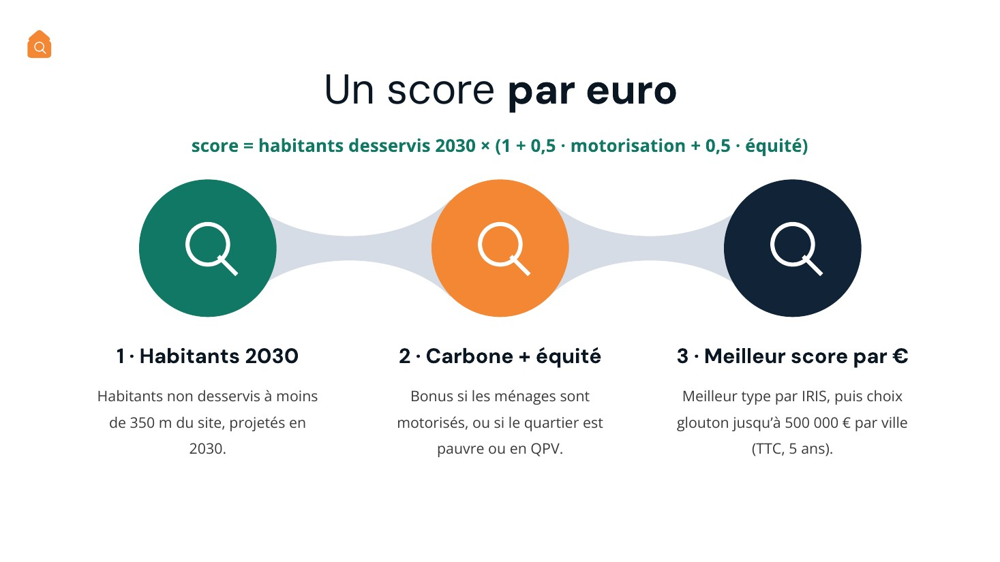</td>
  </tr>
  <tr>
    <td width="50%">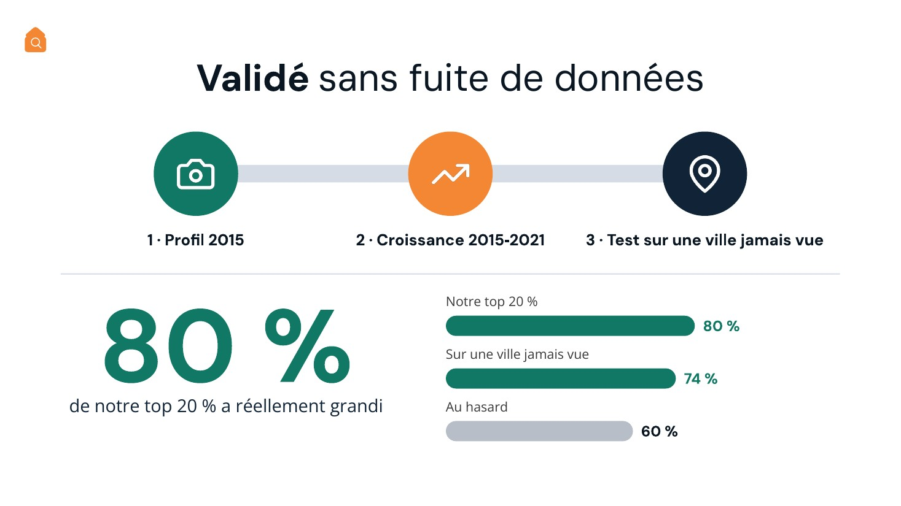</td>
    <td width="50%">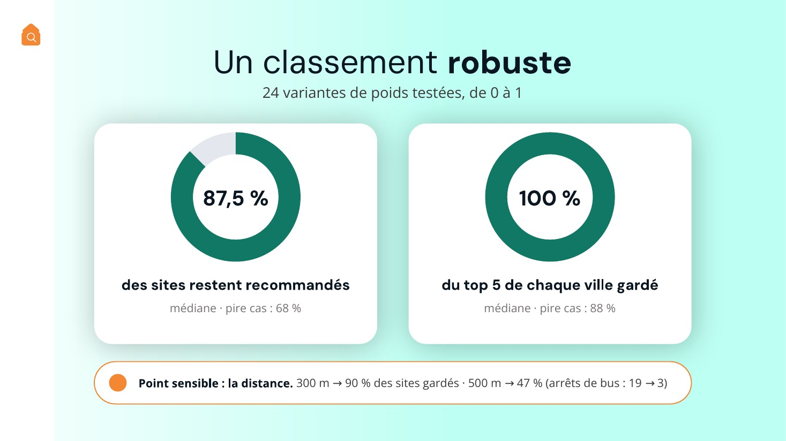</td>
  </tr>
  <tr>
    <td width="50%">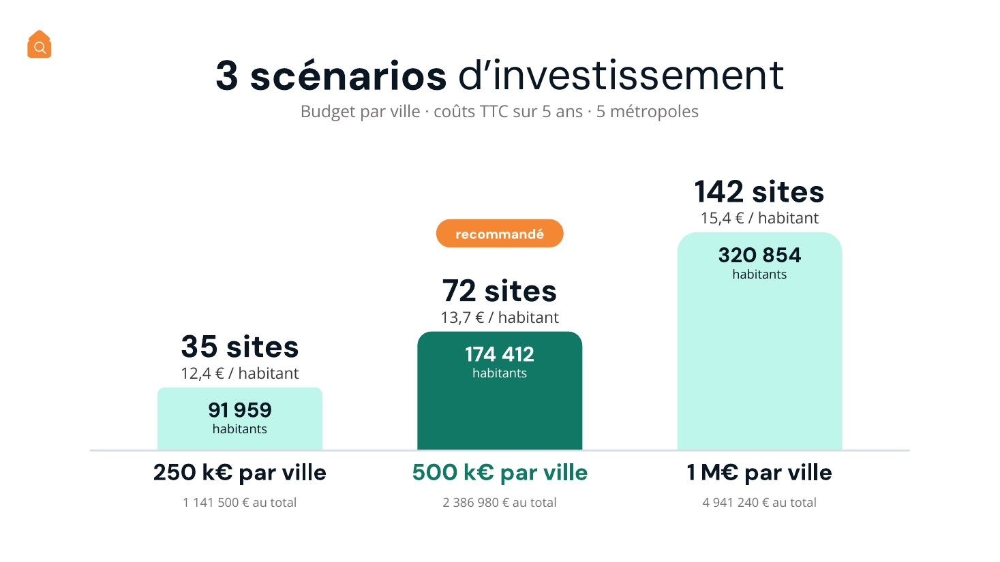</td>
    <td width="50%">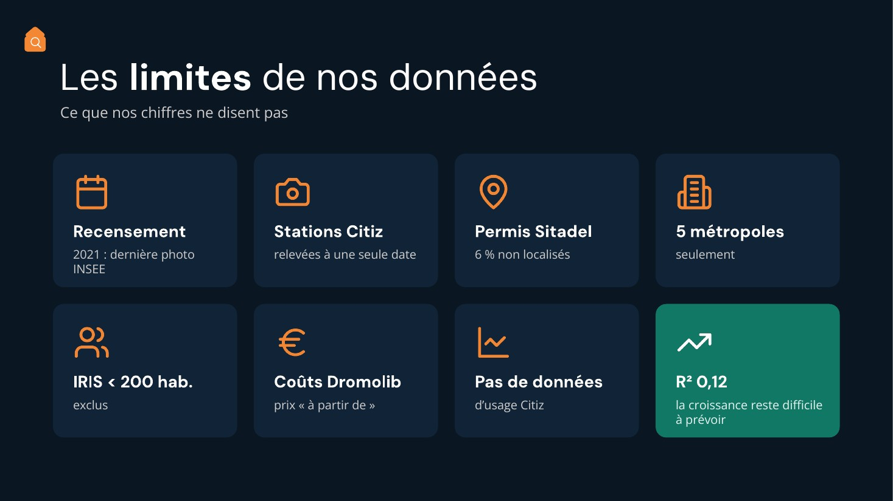</td>
  </tr>
</table>

<sub>Slides are in French, as presented at the hackathon.</sub>

---

## 📚 Data sources

All data is public and open.

| Type | Content | Origin | Why |
|---|---|---|---|
| INSEE, sub-municipal census base 2021 (CSV) | Population by IRIS and age group, 2021 census | [www.insee.fr](https://www.insee.fr/fr/statistiques/fichier/8268806/base-ic-evol-struct-pop-2021_csv.zip) | Current population and age structure |
| INSEE, sub-municipal census base 2015 (XLS) | Same, 2015 census (2017 geography) | [www.insee.fr](https://www.insee.fr/fr/statistiques/fichier/3627376/base-ic-evol-struct-pop-2015.zip) | Past change and training features |
| INSEE Omphale 2022, central scenario (XLSX) | Projected population by department, 2018-2070 | [www.insee.fr](https://www.insee.fr/fr/statistiques/fichier/6652134/projections_scenario_central.xlsx) | Calibrating the 2030 projection |
| IGN IRIS boundaries (Géoplateforme WFS, GeoJSON) | IRIS polygons of the studied municipalities | [data.geopf.fr](https://data.geopf.fr/wfs/ows) | Area, centroids, map |
| Administrative boundaries API (JSON) | Municipalities of each EPCI (inter-municipal body) | [geo.api.gouv.fr](https://geo.api.gouv.fr/epcis/{siren}/communes) | Scope of the 5 metropolitan areas |
| GTFS TBM, TAG, ilévia, STAR, Tisséo (transport.data.gouv.fr) | `stops.txt` of the urban networks | [www.data.gouv.fr](https://www.data.gouv.fr/api/1/datasets/r/10b87ffe-e6bb-494d-93df-bb6019e223d9) | Existing public transport |
| Citiz GBFS (transport.data.gouv.fr) | Citiz stations in Gironde, AURA, Hauts-de-France, Rennes, Occitanie | [www.data.gouv.fr](https://www.data.gouv.fr/api/1/datasets/r/4a69aee4-05ea-45e9-81b7-f9dbdfc7a344) | Existing car sharing |
| Bike-sharing GBFS | Le Vélo TBM, V'Lille, Le vélo STAR | [www.data.gouv.fr](https://www.data.gouv.fr/api/1/datasets/r/51af208b-121d-48ae-b8ee-d45864e450ae) | Existing bike sharing |
| Toulouse Métropole open data (CSV) | VélôToulouse stations | [data.toulouse-metropole.fr](https://data.toulouse-metropole.fr/api/explore/v2.1/catalog/datasets/velotoulouse-localisation-et-caracteristique-des-stations/exports/csv) | Toulouse bike sharing (the Cyclocity GBFS returns 403) |
| Citiz fact sheet (Dromolib, 2025) | €7,250 excl. VAT setup per one-car station, €5,160 excl. VAT/year running cost (electric car supplied by Citiz, depreciation included) | [dromolib.fr](https://dromolib.fr/wp-content/uploads/2025/11/FICHE_Citiz_Autopartage.pdf) | Citiz station cost |
| Cerema, review of 55 SD'AP (accessibility plans) | Average cost of a stop: €15,000 | [www.cerema.fr](https://www.cerema.fr/system/files/documents/2018/02/infographie_panorama_55_dossiers_sd_ap_cle53c7d9.pdf) | Bus stop cost |
| ADEME, evaluation study of bike services | €2,194/bike/year (areas > 500,000 residents), 12 to 15 bikes/station, relevance density 7,000 residents/km² | [www.actu-environnement.com](https://www.actu-environnement.com/media/pdf/dossiers/808-ademe-services-velo.pdf) | Bike station cost and threshold |
| Héran & Pouillaude, "Walking catchment areas around urban public transport stations" | Highly accessible zone: under a 5-minute walk, i.e. 350 m | [hal.univ-lille.fr](https://hal.univ-lille.fr/hal-01891815) | Catchment radius `RAYON_M` |
| SDES, Sitadel: planning permits creating housing (DiDo API, CSV) | One permit per row since 2013: municipality, status, authorisation date, cadastral section and number, housing units created | [data.statistiques.developpement-durable.gouv.fr](https://data.statistiques.developpement-durable.gouv.fr/dido/api/v1/datafiles/8b35affb-55fc-4c1f-915b-7750f974446a/csv) | New construction, a growth predictor |
| Etalab, land register (GeoJSON per municipality) | Cadastral parcels and sections | [cadastre.data.gouv.fr](https://cadastre.data.gouv.fr/data/etalab-cadastre/latest/geojson/communes/) | Locate each permit (parcel, else section) and link it to an IRIS |
| INSEE, sub-municipal Housing base 2021 (CSV) | Main residences and households with at least one car, by IRIS | [www.insee.fr](https://www.insee.fr/fr/statistiques/fichier/8268838/base-ic-logement-2021_csv.zip) | Carbon criterion (car ownership) |
| INSEE Filosofi 2021, 200 m grid (Parquet, data.gouv.fr) | Individuals, households, poor households, total living standard per grid cell | [static.data.gouv.fr](https://static.data.gouv.fr/resources/revenus-pauvrete-et-niveau-de-vie-donnees-carroyees-dispositif-fichier-localise-social-et-fiscal-filosofi/20260309-120901/carreaux-200m-met-3035-2021.parquet) | Fine-grained population for access, poverty (equity criterion) |
| ANCT, priority urban neighbourhoods (QPV) 2024 (GeoJSON) | QPV boundaries | [static.data.gouv.fr](https://static.data.gouv.fr/resources/quartiers-prioritaires-de-la-politique-de-la-ville-qpv/20260115-204323/qpv-2024-geojson.zip) | Equity criterion |
| INSEE, 2022 census documentation (housing file) | IRIS under 200 residents are not published at IRIS level | [www.insee.fr](https://www.insee.fr/fr/statistiques/fichier/8647099/contenu_RP2022_logemt.pdf) | `SEUIL_POP_DIFFUSION` threshold |
| INSEE, departmental and regional projections 2018-2070 | Standard Omphale published only at department and region level | [www.insee.fr](https://www.insee.fr/fr/statistiques/6652134) | Justifies departmental calibration |

---

## ⚖️ Limitations and ethics

**Acknowledged limitations**
- The model explains 12% of the variance: it gives a trend and a ranking, not an exact forecast.
- Omphale is only published at department level, so the 2030 calibration is departmental.
- Distances are straight-line from 200 m grid cells, without the actual walking network.
- 6% of Sitadel permits could not be located; IRIS redrawn between 2015 and 2021 are excluded from training.
- Carbon is approximated by car ownership: with no public modal-shift data, no tonnes of CO₂ are quantified.
- No public running cost for a bus stop was found: only the investment is counted.
- The €500k per city budget and the 0.5 / 0.5 weights are scenario assumptions, to be set with Citiz.

**Ethics**

<p align="center">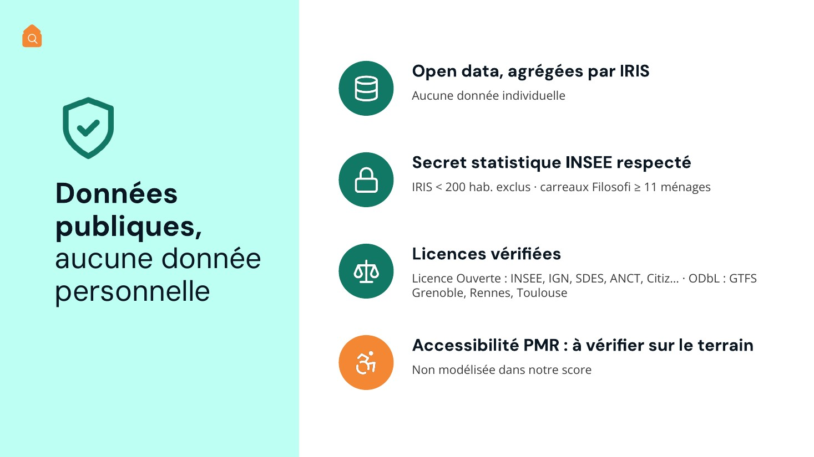</p>

- 🔒 **Privacy**: only aggregated public data, no personal data. IRIS under 200 residents are excluded from exports (INSEE disclosure rule) and Filosofi grid cells follow INSEE's 11-household threshold.
- 🤝 **Equity**: the score favours low-income neighbourhoods and QPV; need is counted on the *unserved* population, so already covered areas are not over-equipped.
- 🗣️ **No stigmatisation**: neutral wording in outputs ("croissance / décroissance" = growth / decline, "besoin d'offre" = service need).
- 📜 **Licences**: sources under the Licence Ouverte (Etalab's French open licence) or equivalent.

---

## 🗂️ Repository structure

```
citiz-station-planner/
├── notebooks/            Fabric pipeline (01 ingestion → 04 Power BI export)
├── data/
│   ├── lakehouse/Tables/ Bronze, silver and gold tables (Parquet)
│   └── stations_citiz_actuelles.geojson
├── outputs/              Power BI exports (CSV, GeoJSON) and model metrics
│   └── executions/       Executed notebooks with their outputs
├── analysis/             Sensitivity analysis (weights, distance, budget)
├── tools/                Spark shim to run the notebooks locally
├── assets/               Deck visuals, team photos, Power BI demo
└── docs/                 Oral presentation script (French)
```

Raw downloads (~390 MB, land register and Filosofi) are not versioned: `01_ingest` downloads them again from the sources above.

## ▶️ Running it

**In Microsoft Fabric**: import the 4 notebooks into a workspace with a default Lakehouse, then run them in order.

**Locally**:
```bash
pip install -r requirements.txt
./tools/run_local.sh                      # full pipeline
./tools/run_local.sh 03_ml 04_export_bi   # starting from the provided tables
python analysis/sensibilite.py            # sensitivity analysis
```
The `tools/spark_shim.py` shim replaces `spark` with Parquet reads and writes in `data/lakehouse/Tables`, without changing the notebooks.

---

## 👥 Team

<div align="center">
<table>
  <tr>
    <td align="center" valign="top" width="20%"><br><b>Hugo Egry</b><br>Team lead &amp; Fabric pipeline</td>
    <td align="center" valign="top" width="20%"><br><b>Loic Noro</b><br>Data &amp; sources</td>
    <td align="center" valign="top" width="20%"><br><b>Rewann Tannou</b><br>ML model</td>
    <td align="center" valign="top" width="20%"><br><b>Manech Laguens</b><br>Score &amp; budget</td>
    <td align="center" valign="top" width="20%"><br><b>Thibault Villez Mognier</b><br>Power BI &amp; demo</td>
  </tr>
</table>

<sub>Mobility Hackathon · Epitech Montpellier · 2026 · <a href="LICENSE">MIT</a> License</sub>
</div>
